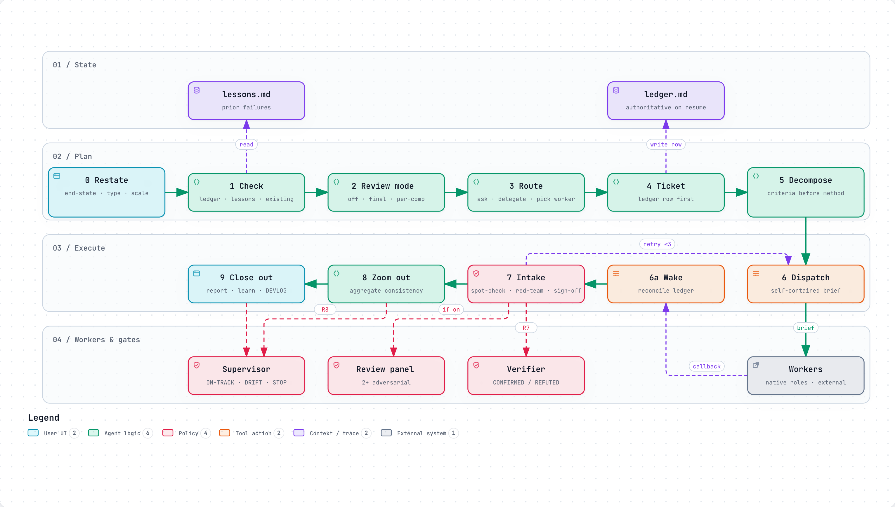
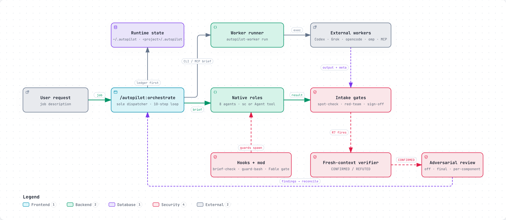

<div align="center">

<picture>
  <source media="(prefers-color-scheme: dark)" srcset="docs/assets/banner-dark.png">
  <source media="(prefers-color-scheme: light)" srcset="docs/assets/banner-light.png">
  
</picture>

<br>

**A full command loop for Claude Code: plan, dispatch, verify, reconcile.**

[](https://github.com/sayre4ux/autopilot/actions/workflows/ci.yml)
[](https://docs.claude.com/en/docs/claude-code/overview)
[](.claude-plugin/plugin.json)
[](LICENSE)
[](https://github.com/sayre4ux/autopilot/stargazers)
[Wiki](https://sayre4ux.github.io/autopilot/) · [Install](#install) · [How it works](#how-it-works) · [Roles](#roles) · [Workers](#workers)

</div>

---

Autopilot is a Claude Code plugin for jobs too big for one context. It plans the work,
dispatches fresh-context agents and external workers, and treats everything that comes back as
unverified until it passes the same gates.

- **Task ledger.** Work survives restarts and context resets.
- **Nine native roles plus external workers.** Codex (GPT-6), Grok, opencode, and omp run
  through one runner.
- **Evidence gates.** Every result gets the same intake, and a fresh-context verifier checks
  all external-worker code.
- **Adversarial review.** Two or more independent reviewers assume the code is wrong.
- **Fails soft.** No external worker or reviewer is ever required.
- **Guardrails in code.** Hooks check briefs for acceptance criteria; on a mods-capable
  Claude Code, a mod keeps security work off Fable and adds a live `/ledger` pane.

## Install

```text
/plugin marketplace add sayre4ux/autopilot
/plugin install autopilot@autopilot-marketplace
/autopilot:setup
```

Setup shows its plan and waits for approval before writing anything. It needs a current
Claude Code with the `opus` and `fable` aliases; the mod was tested on 2.1.287. Restart Claude
Code afterwards. See [docs/install.md](docs/install.md) for requirements, what setup changes,
downgrading, and uninstalling.

## How it works

`/autopilot:orchestrate` runs a ten-step loop. Steps 0–5 plan the job and write the ledger;
steps 6–9 dispatch, take results through the gates, and close out. Code work over three files,
over 200 changed lines, or spanning several components can enter it automatically. Documents
and visuals enter only when you invoke it.

<a href="https://sayre4ux.github.io/autopilot/diagrams/command-loop.html">
  <picture>
    <source media="(prefers-color-scheme: dark)" srcset="docs/assets/command-loop-dark.png">
    <source media="(prefers-color-scheme: light)" srcset="docs/assets/command-loop-light.png">
    
  </picture>
</a>

The orchestrator is the only dispatcher. Results from native roles and external workers pass
the same intake gates, then the verifier and the optional review panel, before they return.

<a href="https://sayre4ux.github.io/autopilot/diagrams/architecture.html">
  <picture>
    <source media="(prefers-color-scheme: dark)" srcset="docs/assets/architecture-dark.png">
    <source media="(prefers-color-scheme: light)" srcset="docs/assets/architecture-light.png">
    
  </picture>
</a>

Click either diagram for the interactive version, with a source link on every node.

## Roles

| Role | Model / effort | Job |
|---|---|---|
| architect | opus / high | Design, trade-offs, arbitration; no production code |
| engineer | opus / medium | Normal code, scripts, data |
| engineer-lite | haiku / medium | Fully specified, self-contained code with an acceptance command |
| senior-engineer | opus / high | Code where a defect is expensive |
| engineer-doc | opus / medium | Documents and visuals, rendered and inspected |
| security-engineer | opus / high | Auth, secrets, crypto, validation, hardening |
| verifier | opus / high | `CONFIRMED` or `REFUTED`; never fixes |
| reviewer | opus / high | Adversarial findings by severity; never fixes |
| supervisor | fable / high | `ON-TRACK`, `DRIFT`, or `STOP` for the whole job |

Efforts are tuned for Opus 5.5. The orchestrator runs on `opus`; Fable supervises rather than
drives, because it costs 2.5x per token and can decline defensive security work.

## Workers

External workers are JSON records in `~/.autopilot/workers/` or the project's `.autopilot/`.
The shipped [presets](workers/presets/) cover GPT-6 through Codex, Grok 4.7, opencode, and
omp. External work gets the same brief and gates as native work; a second failure escalates
to a native role. Autopilot runs on stock Claude Code and uses
[super.engineering](https://super.engineering) as its dispatch vehicle when `sc` is available.

## Field results

From one multi-week production build run under Autopilot (observed, not a benchmark):

- Cross-family review confirmed **25+ critical or major defects in code that already passed
  its tests**.
- On identical briefs, two reviewers' critical findings were **disjoint**; one reviewer
  alone would have missed some.
- Across 54 external-worker dispatches in three model families, **no failure lost work**.

## Docs

The full docs are published at **[sayre4ux.github.io/autopilot](https://sayre4ux.github.io/autopilot/)**.

| Page | Covers |
|---|---|
| [Install](docs/install.md) | Requirements, setup, downgrade to 0.2.0, uninstall |
| [How it works](docs/how-it-works.md) | Roles, entry and delegation, wake channels, state, degradation |
| [Enforcement and the mod](docs/enforcement.md) | Hooks, the Fable gate, `/ledger`, enforcement modes |
| [Workers](docs/workers.md) | Registry, presets, runner, Codex and omp notes |
| [super.engineering](docs/super-engineering.md) | What changes when `sc` is the dispatch vehicle |
| [Adversarial review](docs/review.md) | Review panel, merge rules, full field results |
| [Design](docs/design.md) | Architecture, trust boundaries, invariants |

## Development

```bash
claude plugin validate --strict .claude-plugin/plugin.json
claude plugin test .
uv run pytest -v
```

CI runs all three, the first two on Claude Code 2.1.287. Contributions should keep
user-specific configuration outside the plugin, preserve native degradation, and include
real-run evidence for mechanism changes.

## License

[MIT](LICENSE)

## Star History

[](https://www.star-history.com/?repos=sayre4ux%2Fautopilot&type=date&legend=top-left)
