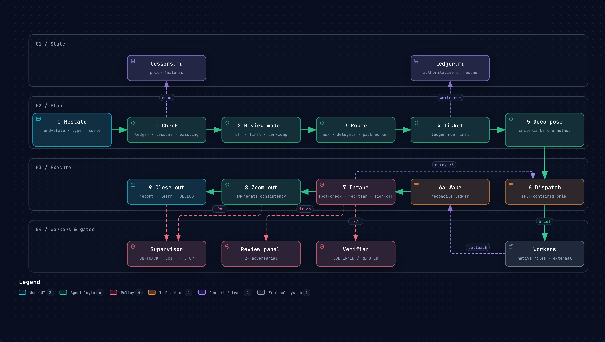
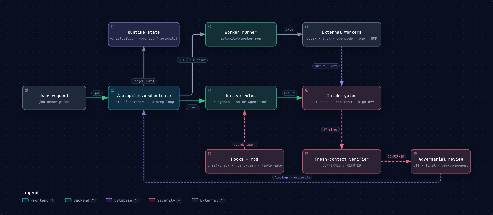

# Autopilot

A Claude Code plugin for jobs too big for one context. It plans the work, dispatches
fresh-context agents and external workers, and treats everything that comes back as unverified
until it passes the same gates.

```text
/plugin marketplace add sayre4ux/autopilot
/plugin install autopilot@autopilot-marketplace
/autopilot:setup
```

## The command loop

Steps 0–5 plan the job and write the ledger; steps 6–9 dispatch, take results through the
gates, and close out. [Open the interactive diagram](diagrams/command-loop.html).

[](diagrams/command-loop.html)

## Architecture

The orchestrator is the only dispatcher. Results from native roles and external workers pass
the same intake gates, then the verifier and the optional review panel.
[Open the interactive diagram](diagrams/architecture.html).

[](diagrams/architecture.html)

## Where to go next

| Page | Covers |
|---|---|
| [Install](install.md) | Requirements, setup, downgrade to 0.2.0, uninstall |
| [How it works](how-it-works.md) | Roles, entry and delegation, wake channels, state, degradation |
| [Workers](workers.md) | Registry, presets, runner, Codex and omp notes |
| [Enforcement and the mod](enforcement.md) | Hooks, the Fable gate, `/ledger`, enforcement modes |
| [Adversarial review](review.md) | Review panel, merge rules, field results |
| [super.engineering](super-engineering.md) | What changes when `sc` is the dispatch vehicle |
| [Design](design.md) | Architecture, trust boundaries, invariants |
